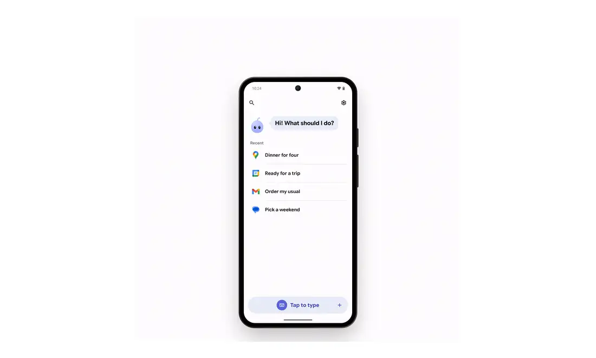
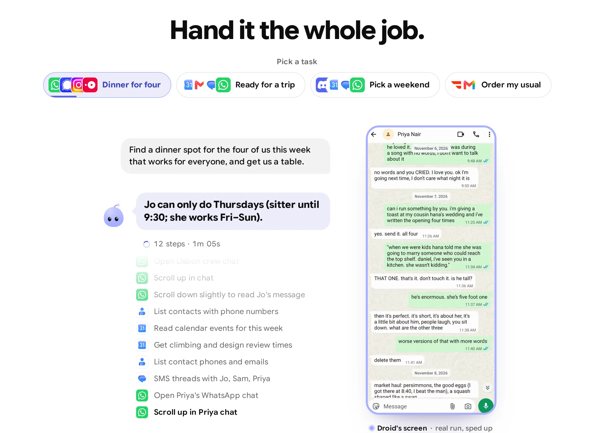
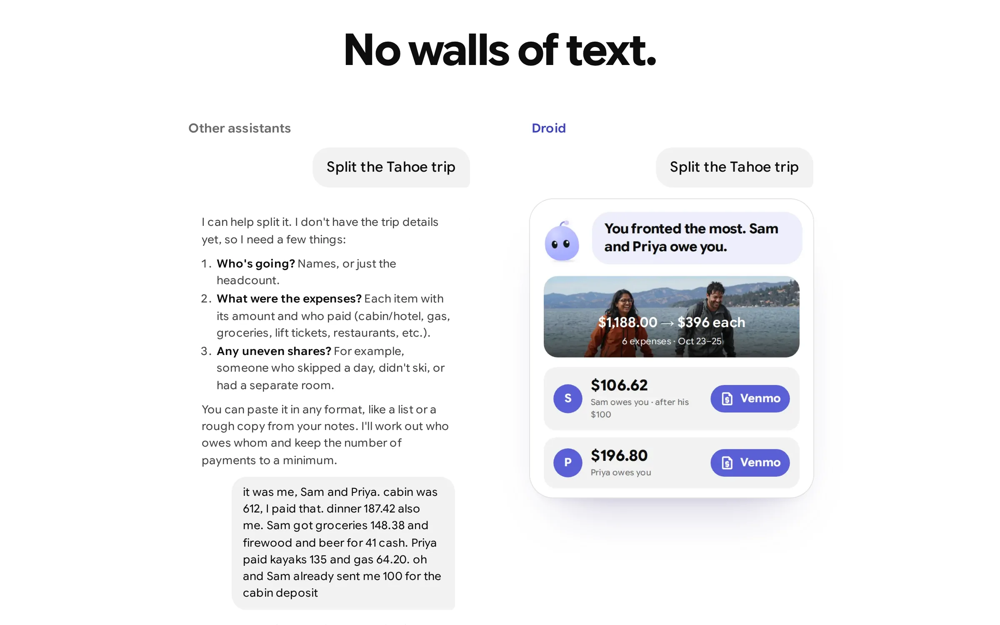
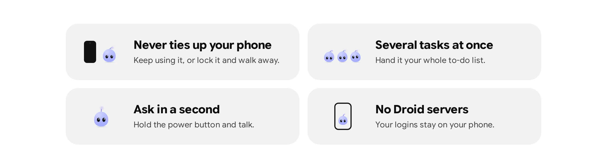

<p align="center"></p>

<h1 align="center">Droid</h1>

<p align="center"><b>Put your phone to work.</b><br>An AI that uses your apps for you.</p>

<p align="center">
  <a href="https://github.com/AlexanderDetkov/droid/releases/latest/download/droid-arm64.apk"></a>&nbsp;
  <a href="https://alexanderdetkov.github.io/droid/"></a>
</p>

<p align="center">
  <a href="https://github.com/AlexanderDetkov/droid/releases/latest"></a>
  
  
  <a href="LICENSE"></a>
</p>

<p align="center"></p>

<p align="center"></p>

<p align="center"></p>

<p align="center"></p>

<p align="center">Start with free AI models and no account, or use your ChatGPT account or a Claude plan.</p>

## Install

You need Android 14 or later.

1. On your phone, download [droid-arm64.apk](https://github.com/AlexanderDetkov/droid/releases/latest/download/droid-arm64.apk)
   and open it. When Android asks, allow installing apps from your browser, then tap Install.
2. Open Droid and follow Dash. Without root, he walks you through turning on Wireless debugging and pairing once.
   When Android asks, tick **Always allow on this network**, so Droid starts by itself after a restart.
3. Pick an AI. Setup takes about five minutes.

Droid takes about 350 MB, plus 860 MB for voice, which downloads on Wi-Fi. Without root, it needs Developer options and
USB debugging left on. Releases are signed with the same key every time (certificate SHA-256
`82:2F:C0:67:BF:29:8D:07:16:DF:D1:54:0F:13:FF:DB:5D:C7:2D:B9:F3:02:F0:24:9D:25:1A:D2:CE:4E:CF:8F`).

To remove it, tap Settings → Setup and updates → Remove Droid's Linux, then uninstall the app.

## Privacy and safety

- What the agent reads goes to the AI you picked: your requests, pictures of its screen, and whatever it opens. Droid
  itself only downloads what setup needs and checks GitHub for updates once a day.
- The agent has real power on your phone, and with root it can read every app's data. A web page or a message could try
  to steer it, so give it jobs you'd trust it with.
- Without root, USB debugging stays on, and some banking apps refuse to run while it is.
- Voice match is weaker than your fingerprint: a recording of your voice can pass it.

## Build

Needs JDK 17 and the Android SDK.

```sh
./gradlew assembleDebug
./gradlew testDebugUnitTest lintDebug
```

On an emulator, the debug build plays a recorded agent, so you can work on the app without an AI account. How Droid works
inside, from its hidden screen to its voice models: [docs/how-it-works.md](docs/how-it-works.md).

Found a problem? [Open an issue](https://github.com/AlexanderDetkov/droid/issues/new/choose) and paste in Setup's
"Copy diagnostics".

## License

Apache-2.0. Droid is an independent project, not affiliated with Anthropic or OpenAI. It installs Claude Code, Codex or
OpenCode from their makers, and you sign in with your own account. Everything else it uses, and their licenses, is listed
in the app under Settings → About.
