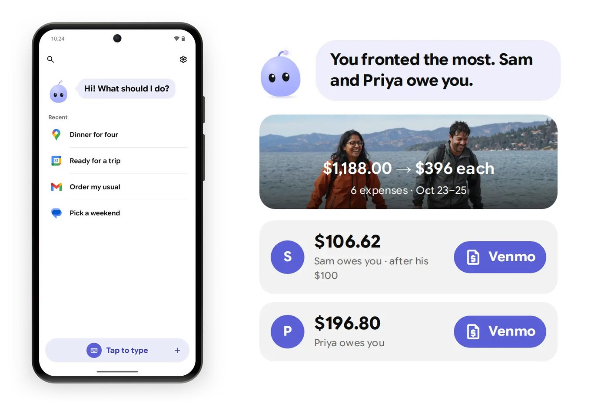

# Droid

<p align="center"></p>

<p align="center"><b><a href="https://github.com/AlexanderDetkov/droid/releases/latest/download/droid-arm64.apk">Download for Android</a></b> · <a href="https://alexanderdetkov.github.io/droid/">Website</a></p>

**Put your phone to work.** Droid is an AI that uses your apps for you. Say what you need, and it does the job on a
screen of its own while you keep using your phone, or lock it and walk away.

## What it does

- **Uses any app on your phone.** It taps and types the way you do, so it works with almost any app, not just websites.
- **Does the whole job.** Find a table for four, order your usual, split a trip: it goes through every app it needs and comes back
  with the result.
- **No walls of text.** Each answer is a small app made for the task: choices to tap, a draft ready to send, one big
  number. You answer with a tap.
- **Never ties up your phone.** You can watch it work, or take over to sign in or pay yourself.
- **Several tasks at once.** Hand it your whole to-do list.
- **Ask in a second.** Hold the power button and talk, from any app or the lock screen. Speech recognition runs on the phone.
- **Your choice of AI.** Free models with no account, your ChatGPT account, or a Claude plan.
- **No Droid servers.** Your logins stay on your phone, and the code is open.

## Install

You need Android 14 or later, rooted or not.

1. On your phone, download [droid-arm64.apk](https://github.com/AlexanderDetkov/droid/releases/latest/download/droid-arm64.apk)
   and open it. When Android asks, allow installing apps from your browser, then tap Install.
2. Open Droid and follow Dash. Without root, he walks you through turning on Wireless debugging and pairing once.
   When Android asks, tick **Always allow on this network**, so Droid starts by itself after a restart.
3. Pick an AI. Setup takes about five minutes.

Droid takes about 350 MB, plus 860 MB for voice, which downloads on Wi-Fi. Without root, it needs Developer options and
USB debugging left on. Releases are signed with the same key every time (certificate SHA-256
`82:2F:C0:67:BF:29:8D:07:16:DF:D1:54:0F:13:FF:DB:5D:C7:2D:B9:F3:02:F0:24:9D:25:1A:D2:CE:4E:CF:8F`).

To remove it, tap Settings → Setup and updates → Remove Droid's Linux, then uninstall the app.

## Privacy and safety

- What the agent reads goes to the AI you picked: your requests, pictures of its screen, and whatever it opens. Droid
  itself only downloads what setup needs and checks GitHub for updates once a day.
- The agent has real power on your phone, and with root it can read every app's data. A web page or a message could try
  to steer it, so give it jobs you'd trust it with.
- Without root, USB debugging stays on, and some banking apps refuse to run while it is.
- Voice match is weaker than your fingerprint: a recording of your voice can pass it.

## Build

Needs JDK 17 and the Android SDK.

```sh
./gradlew assembleDebug
./gradlew testDebugUnitTest lintDebug
```

On an emulator, the debug build plays a recorded agent, so you can work on the app without an AI account. How Droid works
inside, from its hidden screen to its voice models: [docs/how-it-works.md](docs/how-it-works.md).

Found a problem? [Open an issue](https://github.com/AlexanderDetkov/droid/issues/new/choose) and paste in Setup's
"Copy diagnostics".

## License

Apache-2.0. Droid is an independent project, not affiliated with Anthropic or OpenAI. It installs Claude Code, Codex or
OpenCode from their makers, and you sign in with your own account. Everything else it uses, and their licenses, is listed
in the app under Settings → About.
